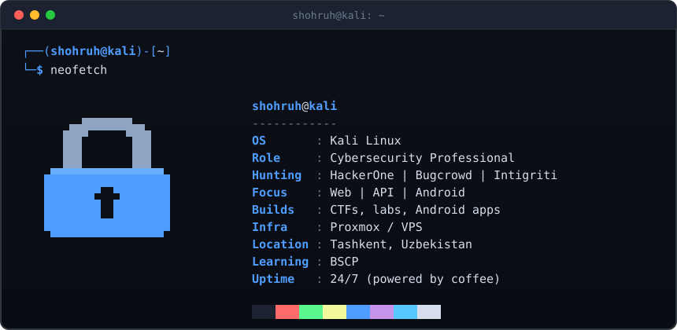

<div align="right">
  <a href="README.windows.md"></a>
</div>

<div align="center">



<br />



</div>

<br />

## `$ nmap -sV localhost`

```console
$ nmap -sV --top-skills localhost

Starting Nmap ( https://nmap.org )
Nmap scan report for shohruh (127.0.0.1)
Host is up (0.000010s latency).

PORT        STATE  SERVICE        VERSION
22/tcp      open   kali-linux     daily driver
80/tcp      open   web-security   Burp Suite, PortSwigger Academy
443/tcp     open   api-security   bug bounty recon and PoCs
5555/tcp    open   android        app development and security research
8006/tcp    open   proxmox        Proxmox VE, VPS, home lab
31337/tcp   open   ctf-labs       CyberBroLabs: CTFs and lab environments

Service detection performed. 6 services found.
```

## `$ ls ~/projects`

```console
$ ls -la ~/projects
total 2
drwxr-xr-x  shohruh  ThreatEye/      AI-powered email security lab (open source)
drwxr-xr-x  shohruh  CyberBroLabs/   CTF challenges, labs and infrastructure
```

- [**ThreatEye**](https://github.com/shohruhyuldashev/ThreatEye-AI-Email-Security) - AI-powered email security lab (open source)
- **CyberBroLabs** - self-built CTF challenges, labs and infrastructure

## `$ crontab -l`

```console
$ crontab -l
# m   h  dom mon dow  command
0     *  *   *   *    coffee --refill
*/30  *  *   *   *    bounty-hunt --in-scope-only
@reboot               learn --topic=BSCP
```

## `$ git log --stat`

<div align="center">


</div>

## `$ cat ~/.stack`

<div align="center">


</div>

## `$ ssh shohruh@contact`

<div align="center">

<a href="https://www.linkedin.com/in/shohruh-yuldashev/"></a>
<a href="mailto:shohruhyuldashev139@gmail.com"></a>
<a href="https://github.com/shohruhyuldashev"></a>

</div>

```console
$ echo "Responsible disclosure only. Happy hunting."
Responsible disclosure only. Happy hunting.
$ exit
logout
```


