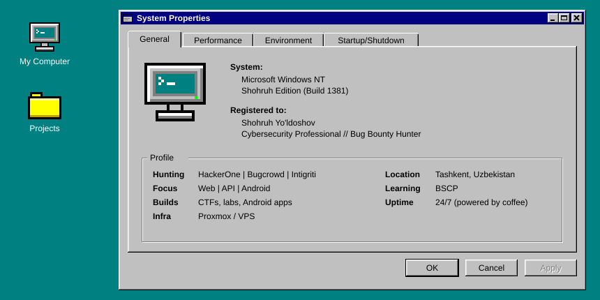
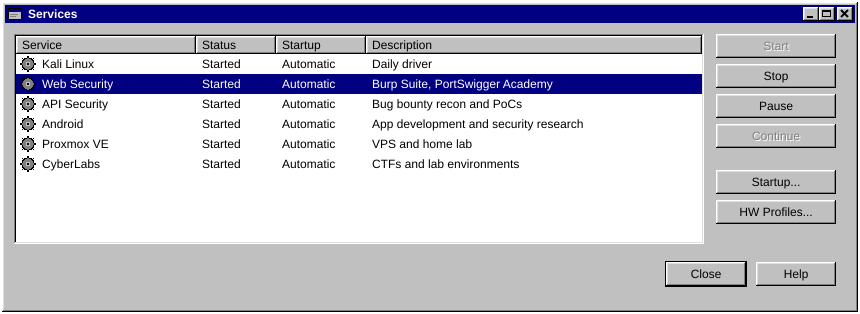
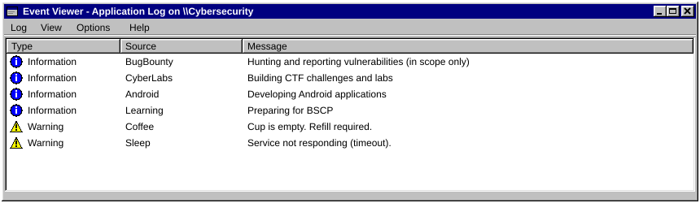
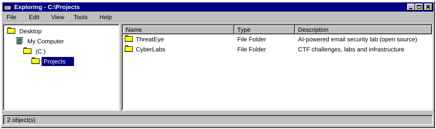
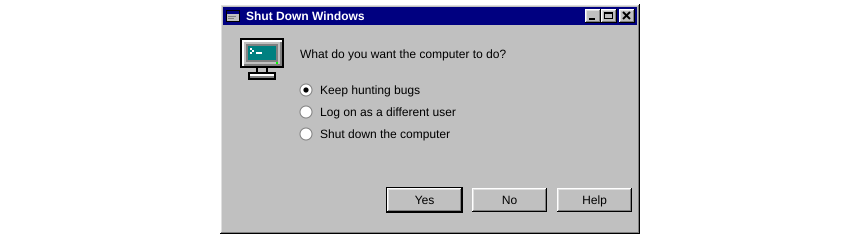
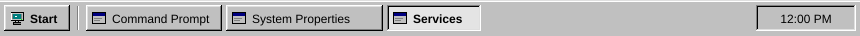

  

 

 

 

 

- [**ThreatEye**](https://github.com/shohruhyuldashev/ThreatEye-AI-Email-Security) - AI-powered email security lab (open source)
- **CyberBroLabs** - self-built CTF challenges, labs and infrastructure

  

 

 

